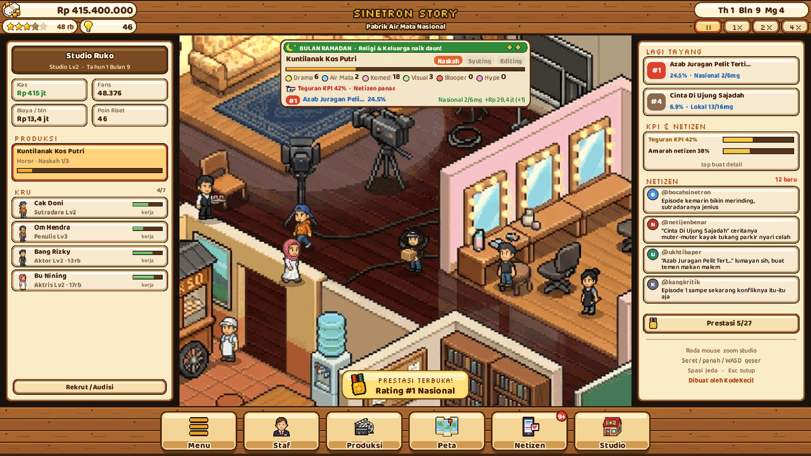
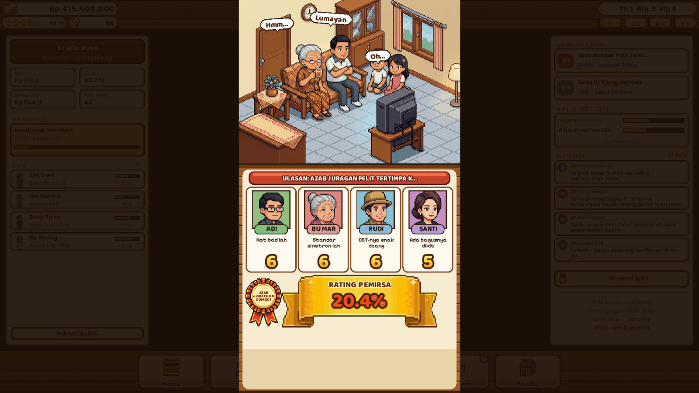
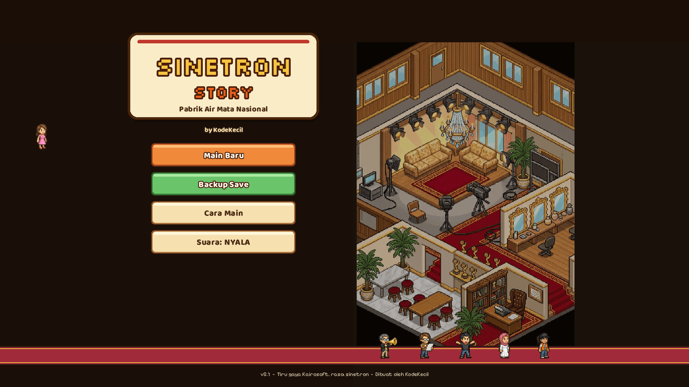
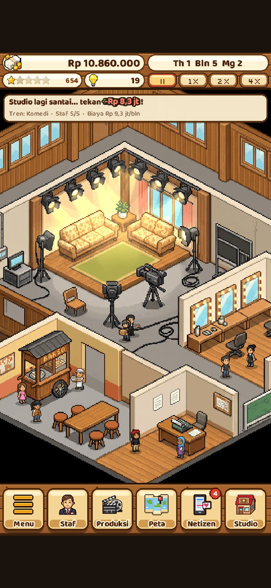
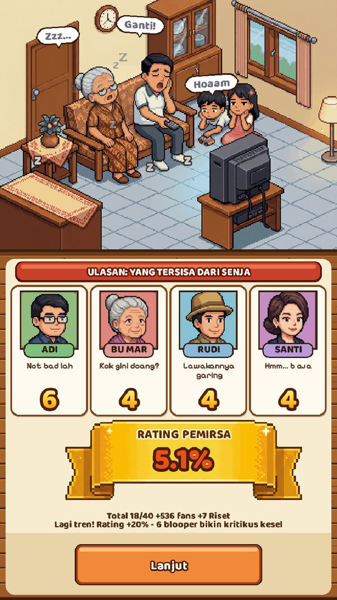
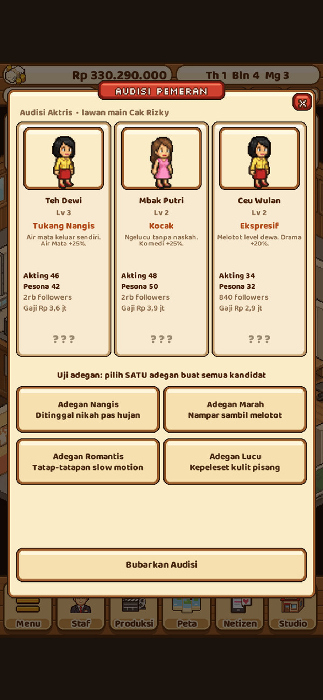
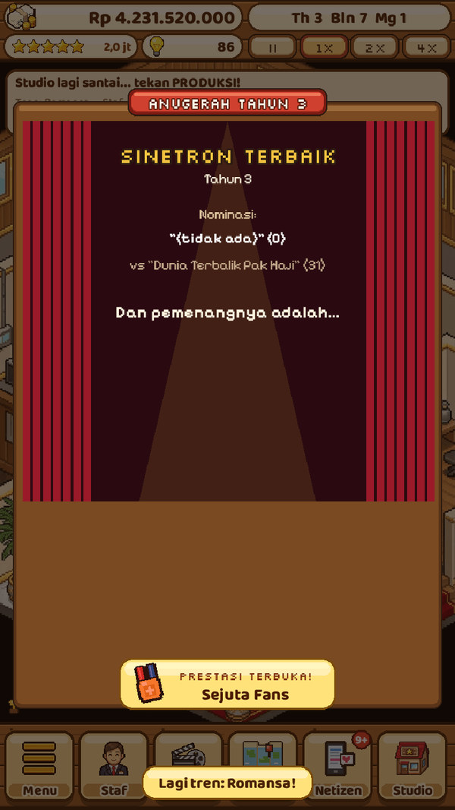

<div align="center">

**English** · [Bahasa Indonesia](README.id.md)

# Sinetron Story

**Run a TV-drama studio and turn tearjerkers, ghost stories and *azab* melodramas into ratings gold, in a pixel-art management sim for the browser.**

[](https://www.typescriptlang.org/)
[](https://phaser.io/)
[](https://vite.dev/)
[](#installing-as-an-app)
[](LICENSE)
[](https://sinetron-story.axolotl1429.workers.dev)

### [▶ Play now](https://sinetron-story.axolotl1429.workers.dev)



</div>

## About

Sinetron Story is a Kairosoft-style (think *Game Dev Story*) management sim about making *sinetron*, Indonesia's beloved, over-the-top TV soap operas. Start in a garage studio with a tiny crew, pick a genre and setting, cast your leads, shoot, edit, and wait for the critics and the viewers at home to deliver their verdict. Climb from local TV to national TV and streaming, fight weekly rating wars against rival stations, survive gossip, boycotts and the broadcasting commission, and grow into the *Istana Sinetron*.

A full career lasts ten in-game years and ends with a recap and a title, then you can keep playing. The UI is in casual Indonesian. Every show, station, singer, sponsor and celebrity in the game is fictional.

## Screenshots

<table>
  <tr>
    <td colspan="2"></td>
    <td colspan="2"></td>
  </tr>
  <tr>
    <td></td>
    <td></td>
    <td></td>
    <td></td>
  </tr>
</table>

## Features

- **The full production cycle.** Pick from 10 genres (Romansa, Komedi, Keluarga, Azab, Religi, Remaja, Horor, Laga, Siluman, Kolosal) and 12 settings, choose a platform and a budget, cast the leads, then watch the crew move through script, shooting and editing, bloopers included.
- **The rating reveal.** A family on the couch reacts to your show while four critics score it, then the viewer rating drops. Hidden genre and setting combos reward experimentation.
- **Weekly rating wars.** Every airing show fights five rival shows on its platform's chart. Fall behind and the station pulls it; stay at number one and earn bonuses, promos and extra episodes.
- **Crew and stars.** Hire directors, writers, camera operators and actors. Run auditions to test chemistry, handle raise demands and strikes, and watch actors become social-media celebrities that rivals try to poach.
- **Plot twists, OSTs, sequels.** Play plot-twist cards mid-season (overdo it and netizens get bored), sign a fictional dangdut singer for the theme song, and spin hits into sequels and spin-offs.
- **Location shoots.** Pick shoots on a pixel map of the country and abroad, each with its own bonuses and hidden combos.
- **A noisy world.** Gossip about your actors, #Boikot campaigns, product-placement sponsors, an X-style netizen timeline, and warnings from the fictional broadcasting commission (KPI) when you lean too hard on azab, horror and plot twists.
- **Ramadan season.** A moving Ramadan calendar boosts religious and family dramas, with a special sponsored Ramadan slot.
- **Grow the studio.** Five studio levels from Studio Garasi to Istana Sinetron, equipment, exclusive star contracts and big ad campaigns.
- **Ten-year career,** 27 achievements, yearly awards, a Hall of Fame, a guided tutorial, and save backups as a file or a code.
- **Plays anywhere.** Responsive layout for phones, landscape and wide screens, installable as a PWA and playable offline.

## How to play

1. **Hire a crew.** You need at least a writer, a camera operator and actors. The tutorial starts you off.
2. **Start a production.** Choose a title, genre and setting, then a platform and budget, then cast the leads.
3. **Produce.** Let the crew work through script, shooting and editing. Pick a location, an OST or a sponsor if you like.
4. **Air it.** Watch the rating reveal, then keep the show on the chart with promos and plot twists.
5. **Grow.** Spend money and research points on staff, equipment and studio upgrades. Watch your debt: the bank seizes the studio after three months deep in the red.

## Controls

| Action | Desktop | Phone |
|---|---|---|
| Zoom the studio | Mouse wheel | Fixed fit-to-screen view |
| Pan | Drag, arrow keys or WASD | Not needed on phones |
| Pause / resume | Space | Speed buttons |
| Close dialog | Esc | ✕ button |
| Scroll long dialogs | Wheel, arrows, PgUp / PgDn | Drag |

## Tech stack

- [Phaser 4](https://phaser.io/) for rendering, input and scenes
- [TypeScript 7](https://www.typescriptlang.org/) in strict mode, type-checked with `tsc --noEmit`
- [Vite 8](https://vite.dev/) with [vite-plugin-pwa](https://vite-pwa-org.netlify.app/) (offline precache, manifest) and [vite-plugin-singlefile](https://github.com/richardtallent/vite-plugin-singlefile) for a one-file build
- WebAudio synthesis for all music and sound effects, no audio files
- [Playwright](https://playwright.dev/) for end-to-end, responsive, audio, security and soak tests
- Python (Pillow, NumPy, SciPy) for the sprite pipeline
- Fonts: Pixelify Sans, Silkscreen and Baloo 2 via Fontsource

## Project structure

```
sinetron-story/
├── index.html
├── public/              # _headers (CSP and caching), PWA icons
├── src/
│   ├── main.ts          # boot, responsive scaling
│   ├── scenes/          # Boot, Title, Game
│   ├── sim.ts           # pure simulation (no Phaser): production, scoring, revenue, events, awards
│   ├── rating.ts economy.ts twists.ts ost.ts v5.ts   # rating war, economy, plot twists, OST, gossip, KPI
│   ├── data.ts titles.ts locations.ts             # genres, themes, title generator, map locations
│   ├── state.ts sanitize.ts backup.ts             # save format, migration, backup import/export
│   ├── screens*.ts sidepanel.ts ui.ts tutorial.ts # dialogs and UI kit
│   ├── studio.ts art.ts assets.ts                 # studio layout, procedural bits, sprite loading
│   ├── audio.ts         # WebAudio sequencer and SFX
│   └── assets/          # sprite sheets and backgrounds
├── tools/               # e2e, responsive, audio and security tests, balance bot, asset pipeline
├── vite.config.ts       # PWA build
├── vite.single.config.ts    # single-file build
└── wrangler.embed.jsonc # Cloudflare Worker config
```

## Getting started

Requires Node.js 20.19 or newer.

```bash
git clone https://github.com/vhmns14/sinetron-story.git
cd sinetron-story
npm install
npm run dev          # local dev server with hot reload
npm run typecheck    # strict TypeScript check
npm run build        # production PWA build into dist/
npm run preview      # serve the production build
npm run build:single # whole game in one HTML file, in dist-single/
```

### Tests

Most tests drive the real game in headless Chromium, so build first and install a browser once:

```bash
npx playwright install chromium
npm run build
npm run test:e2e     # full playthrough with screenshots in shots/
npm run test:v5      # backups, tutorial, gossip, auditions, sponsors, KPI, endings, save migration
npm run test:resp    # layouts from small phones to 1920x1080, plus live resize
npm run audit:sec    # served headers, zero CSP violations, backup-import fuzzing
npm run test:soak    # a bot plays 10 in-game years
npm run test:titles  # title generator sanity check
npm run test:audio   # sequencer test with a mocked AudioContext
npm run balance      # headless balance simulation on the pure sim
```

## Deployment

`npm run build` produces a static site in `dist/` with a relative base path, so it works on any static host or sub-path (Cloudflare, Netlify, GitHub Pages, your own server). `public/_headers` carries a strict Content Security Policy and cache rules for hosts that read it.

**Cloudflare Workers (static assets):**

```bash
npm run build
npx wrangler deploy --assets dist --name sinetron-story --compatibility-date 2026-10-01
```

**Cloudflare Workers (single embedded script),** as used for the live site. Edit `wrangler.embed.jsonc` with your own account and route first:

```bash
npm run build
python3 tools/build-embed.py     # writes deploy-embed/worker.js
npx wrangler deploy -c wrangler.embed.jsonc
```

### Installing as an app

Open the game in Chrome, Edge or Safari and choose *Install* or *Add to Home Screen*. After the first load it works offline.

## Roadmap and known limitations

- The UI is Indonesian only. An English translation is not planned yet.
- Saves live in the browser's localStorage. Clearing site data deletes them, so use *Backup Save* to keep a copy.
- `npm audit` flags a build-time-only advisory in a dependency of vite-plugin-singlefile. Nothing from it ships to players.
- Balance is tuned with bots. Feedback from real players is welcome.
- The test suite needs a local Chromium through Playwright and is not wired to CI yet.
- Ideas for later: more genres and settings, more plot-twist cards, more overseas shooting locations.

## License

[MIT](LICENSE) © 2026 vahmi sofyan. Made by KodeKecil.
